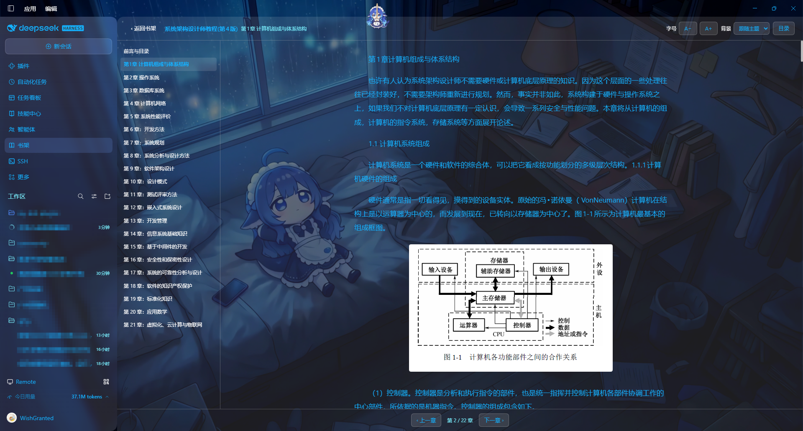

# 书架 · Bookshelf

> 一个跑在 [DeepSeek Harness](https://github.com/deepseek-ai/DeepSeek-Harness) 里的本地书籍阅读器插件：
> 扫描本地 **EPUB / TXT / PDF / DOCX** 文档，建立一本本地书架，然后在面板里离线阅读。

[](LICENSE)
[](https://github.com/deepseek-ai/DeepSeek-Harness)


*书架：搜索、排序、分组、封面缩略图，右上角「扫描文件夹」把本地目录收进书架。*



*阅读器：左侧目录、正文与插画、字号与护眼背景；快捷键 `←` / `→` 翻章，`Esc` 回书架。*

## 特点

- **完全本地**：文件始终留在你自己的磁盘上，插件不复制、不上传、不联网。
- **零第三方依赖**：EPUB / DOCX 的解压、PDF 的解析、图片的解码全部用 Node 自带能力自己实现，
  `npm install` 之后不需要任何额外包。
- **自己写的 PDF 解析器**：扫描对象表 → 解开内容流 → 按字体的 ToUnicode 映射还原文字，
  按真实字宽还原段落，并按页面上的位置把插图放回正文。

## 功能

- **扫描本地书库**：填一个本地文件夹的绝对路径（宿主有原生选择器时也能直接「浏览…」），
  递归查找其中的 `.epub` / `.txt` / `.pdf` / `.docx` 文件，勾选后加入书架。
- **本地书架**：每本书记录标题、作者、体积、格式、封面与阅读进度；书库保存在
  `~/.dsh-book-reader/library.json`。
- **插画与封面**：文档里的插画按原位呈现，封面在书架上作为缩略图；
  两者都从文档内部解出并缓存到 `~/.dsh-book-reader/cache/`，浏览器按需取用。
- **排序**：按**加入时间**、**最近阅读**、**文件名**三种方式排列，每种都支持正序／倒序；
  选择会被记住，下次打开沿用。
- **分组**：按**文件夹**、**作者**、**格式**分组（也可不分组），分组标题可折叠。
- **搜索**：按书名、作者或文件名即时过滤。
- **阅读器**：章节目录、上下章切换、字号调节、护眼阅读背景（通过主题服务叠加 token 层，
  不影响页面其余部分），阅读进度自动保存。

## 支持的格式

| 格式 | 说明 |
| --- | --- |
| **EPUB** | 直接解包（`node:zlib` 自带解压），章名取自书自己的目录，插画按原位呈现，封面自动抽取。 |
| **TXT** | 自动识别 UTF-8 / UTF-16 / GB18030 编码，并按「第 N 章」「楔子」「番外」等标题切章。 |
| **PDF** | 自带解析器：对象表 → 内容流 → ToUnicode 还原文字；有书签目录的按目录分章，没有的按页分章；章前的目录单列一章。段落按字体真实字宽还原（满行接上行算同一段，首行缩进另起一段，中文的字间距不会被误当成空格）。插图从 PDF 里解出来（JPEG 原样保存，其余编码转成 PNG）并按页面位置放回正文。现代 PDF 把目录、页面对象打包进压缩对象流，解析器会解开它们；书签目标写成命名目标时按名字树解析。 |
| **DOCX** | 解出正文、标题层级与内嵌图片（WordprocessingML）。 |

已知边界：

- **扫描件 PDF 没有文字层**，会明确提示「这个文档没有可提取的文字」，而不是给你一片空白；
  OCR 不在范围内。
- 旧版二进制 `.doc` 不支持（扫描时会直接跳过）。
- PDF 的插图只支持能直接解码的编码（DCT / Flate / 调色板 + 软掩码 / CMYK）；
  JPEG 2000、CCITT 等会跳过。

## 安装

需要 **DeepSeek Harness 0.2+**（自带 Node.js 22.12+ 运行时）。

包发布在 npm 上，名字是 **`@lroyia/dsh-book-reader`**。

### 从 npm 装（推荐）

图形界面：**插件**页 → **安装插件** → 填入包名

```
@lroyia/dsh-book-reader
```

命令行：

```bash
dsh plugin --profile desktop add @lroyia/dsh-book-reader
```

`dsh plugin` 只是把参数转交给 profile 目录里的 pnpm，因此任何 pnpm 能装的写法都行。

装完后在插件页把「书架」**启用**，左侧栏就会出现它的图标。

### 从源码装

```bash
git clone https://github.com/Lroyia/dsh-book-reader.git
dsh plugin --profile desktop add ./dsh-book-reader
```

或者手动：把仓库目录放进任意位置，在 profile 的 `package.json` 的 `dependencies` 里加一条
`"@lroyia/dsh-book-reader": "link:/绝对路径/dsh-book-reader"`，并在 `dsh.profile.bundles`
数组里加上 `"@lroyia/dsh-book-reader"`，然后在 profile 目录里跑一次 `pnpm install`。

## 使用

1. 点侧栏的「书架」图标打开面板，点右上角**扫描文件夹**；
2. 填入本地文件夹的绝对路径（也可以点「浏览…」用系统的目录选择器）；
3. 勾选要的书，点**加入书架**——入库是分批进行的，界面实时显示进度；
4. 点任意一本书的**开始阅读**，左侧是目录，`←` / `→` 翻章，`Esc` 回书架。

## 数据与隐私

| 位置 | 内容 |
| --- | --- |
| `~/.dsh-book-reader/library.json` | 书架：每本书的路径、标题、作者、格式、封面、阅读进度 |
| `~/.dsh-book-reader/cache/<bookId>/` | 从文档里解出的封面与插画 |

- 插件**只读取已经进入书架的文件**，不会扫描你没点名的目录。
- 所有接口都带同源回环闸门：只有本机回环、且由浏览器自身发起的请求才能进入，
  因此插件不会把任意远程页面变成一个读本地文件的接口。
- 删掉 `~/.dsh-book-reader` 就是删掉全部数据；书还在原地。

## 结构

```
index.js          Host 半边：注册 /api/book-reader/* 路由
client.js         浏览器半边：侧栏图标 + 书架 / 扫描 / 阅读三个界面
lib/zip.js        最小 ZIP 读取器（EPUB / DOCX 容器），整读与定位读两种方式
lib/epub.js       EPUB 结构解析（container → OPF → spine → 正文与插画），封面解析
lib/pdf.js        PDF 解析器（对象表、内容流、ToUnicode、书签目录、插图解码）
lib/docx.js       Word 文档解析（正文、标题层级、内嵌图片）
lib/images.js     插图与封面的本地缓存
lib/text.js       TXT 编码识别与分章
lib/store.js      本地书架文档（原子写入）
```

宿主与浏览器各占一半：`index.js` 是 Host 半边，负责读文件和注册路由；
`client.js` 是浏览器半边，负责界面。两者之间只通过插件自己的 HTTP 接口说话。

## 开发

```bash
node --check index.js && node --check client.js   # 语法检查
```

改完 `index.js` 后需要把插件**停用再启用**一次，Host 半边才会重新载入；
`client.js` 刷新页面即可生效。

推送到 `main` 会跑 CI（语法检查 + 清单一致性）。

## 发布

版本号写在 `package.json` 里，发布由标签触发：

```bash
# 1. 改版本号
npm version 0.1.1 --no-git-tag-version
git commit -am "版本号定为 0.1.1"

# 2. 打标签并推送 —— workflow 会核对标签与 package.json 的版本是否一致
git tag -a v0.1.1 -m "书架 v0.1.1"
git push origin main && git push origin v0.1.1
```

`.github/workflows/publish.yml` 会在标签推送后把包发到 npm（带 provenance 溯源）。
它需要仓库里有一个 `NPM_TOKEN` 密钥：

1. 到 npmjs.com → 右上角头像 → **Access Tokens** → **Generate New Token**，填一个名字，
   然后按 npm 当前的表单设置：

   | 表单项 | 选什么 | 为什么 |
   | --- | --- | --- |
   | **Bypass two-factor authentication** | **勾上** | npm 要求 CI 发布用的 token 必须能绕过 2FA，不勾会被拒（403） |
   | **Permissions** | **Read and write (publish and stage)** | 只有这个能真正发布新版本 |
   | **Select Packages** | **All Packages** | 首次发布时包还不存在，限定到具体包会选不到它 |
   | **Expiration** | 按需，建议 90 天 | 到期换一枚新的 |

   > 若报 403 且提示 `Two-factor authentication or granular access token with bypass 2fa enabled`，
   > 就是上面第一项没勾。

2. 复制生成的 token（**只显示这一次**）；
3. 到 GitHub 仓库 → **Settings** → **Secrets and variables** → **Actions** →
   **New repository secret**，名字填 `NPM_TOKEN`，值粘贴那个 token。

发布成功后包名就是 `@lroyia/dsh-book-reader`，`dsh plugin --profile <profile> add @lroyia/dsh-book-reader`
即可安装。

> **下一步建议**：npm 已宣布「带 bypass 2FA 的直接发布 token」将在 **2027 年 1 月**下线，
> 官方推荐改用免密钥的 **Trusted Publishing（OIDC）**：等首版发上去后，在 npm 包页面的
> 设置里加一个 Trusted Publisher（仓库 `Lroyia/dsh-book-reader`、工作流文件名 `publish.yml`），
> 之后 GitHub 里的 `NPM_TOKEN` 就可以删掉了——本仓库的 workflow 已经带上了 `id-token: write` 权限。

## 许可

[MIT](LICENSE)
